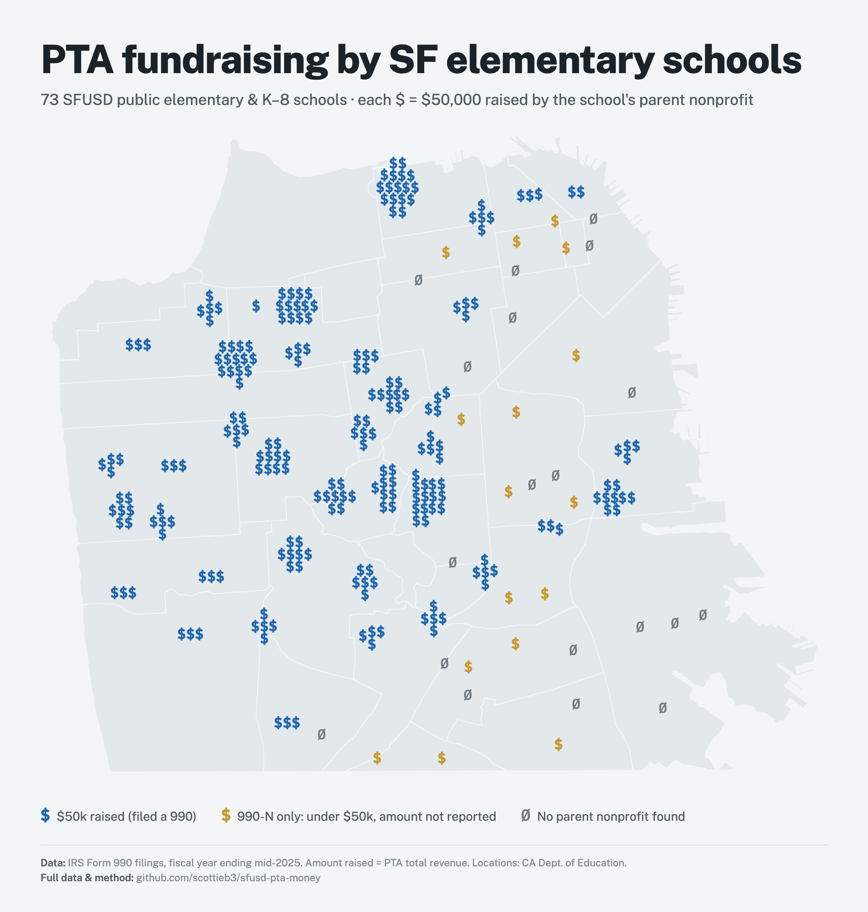
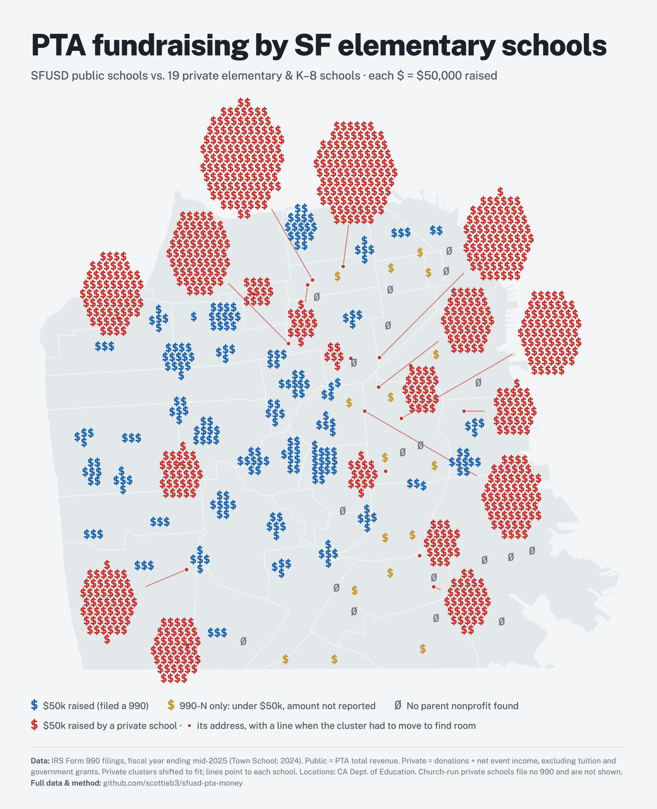
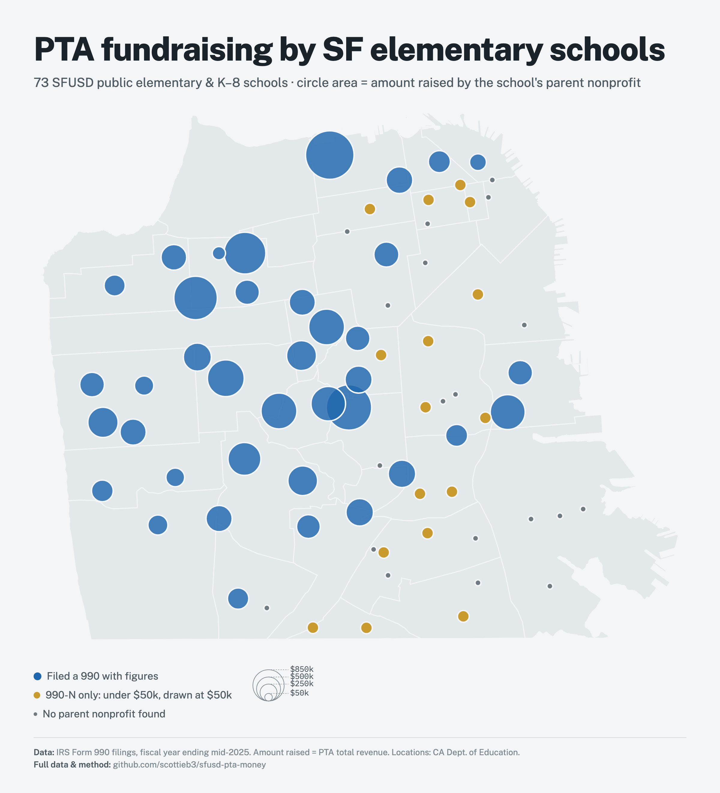
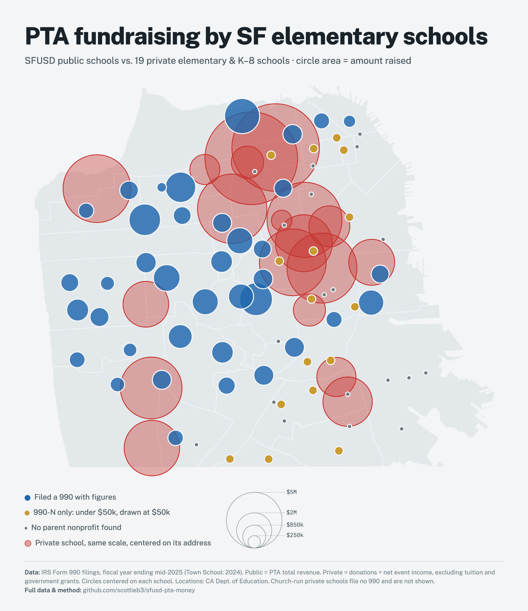

# SFUSD PTA Money

Where parent fundraising money goes in San Francisco's public elementary schools, and how it compares with the city's larger private elementary schools.

**Interactive map:** open [`index.html`](index.html), or the GitHub Pages site once it is enabled: https://scottieb3.github.io/sfusd-pta-money/

The map has two views, switchable with the buttons above it:

- **Dollar signs.** Each `$` is $50,000 raised, rounded to the nearest $50k (minimum one). Blue is a PTA that filed a full return, beige is a PTA that filed only the 990-N postcard (under $50k, amount not reported), and a grey `Ø` is a school with no parent nonprofit found.
- **Sized dots.** Circle area is proportional to the amount raised.

The **Include private schools** switch layers 19 private schools onto either view in red, on the same $50k scale. In the dollar view the private clusters are too large to fit beside their schools, so each sits in the nearest open space with a thin line to its address. The lines never cross. In the dot view the private circles are centered on their addresses.

## Static images

Four 2400px-wide PNGs in [`images/`](images/), one per view:

| | Public schools only | With private schools |
|---|---|---|
| **Dollar signs** |  |  |
| **Sized dots** |  |  |

## Files

| Path | What it is |
|---|---|
| `index.html` | The interactive map. Self-contained apart from Google Fonts. |
| `images/` | Static PNGs of the four map views, for sharing. |
| `schools.csv` | One row per school: 73 SFUSD elementary and K–8 schools plus 19 private schools. |
| `filings/public/` | 41 IRS Form 990 / 990-EZ returns (XML) for the PTAs that filed full returns. |
| `filings/private/` | 20 IRS Form 990 returns (XML) for the private schools: each school's FY2025 return, plus Town School's FY2024 return. |

Each row's `source_files` column names the return(s) its figures came from. The XML is the IRS's own e-file data. Tag names map directly to form lines, for example `CYTotalRevenueAmt` for Part I line 12 and `TotalContributionsAmt` for Part VIII line 1h.

## `schools.csv` columns

| Column | Meaning |
|---|---|
| `name`, `official_name` | Short name used on the map, and the CDE directory name (public) or legal name (private). |
| `type` | `public` or `private`. |
| `category` | PTA filed a full 990/990-EZ, PTA filed a 990-N only, no parent nonprofit found, or private school. |
| `grades`, `address`, `city`, `zip`, `latitude`, `longitude` | Public schools come from the California Department of Education directory. Private schools use the address on their 990, geocoded with the US Census geocoder. |
| `cde_cds_code` | State school ID (public schools only). |
| `raised` | Amount raised in the fiscal year, defined differently for public and private schools (see `raised_definition` and Method below). Blank when no figure exists. |
| `fiscal_year_end` | End of the fiscal year the figures cover. |
| `total_revenue` | Total revenue on the return. For private schools this is mostly tuition. |
| `total_assets` | Total assets at year end. |
| `cash_and_savings` | Cash plus savings and temporary cash investments (990 Part X lines 1–2). On a 990-EZ, cash, savings and investments are reported as one line (Part II line 22), and that combined figure appears here. |
| `investments` | Publicly traded and other securities, and program-related investments (990 Part X lines 11–13). Blank for 990-EZ filers. |
| `land_buildings_equipment` | Land, buildings and equipment, net of depreciation (990 Part X line 10c; 990-EZ line 23). |
| `other_assets` | Everything else: receivables, pledges, prepaid expenses and similar. Equal to `total_assets` minus the three columns above. |
| `endowment_balance` | Year-end endowment balance from Schedule D Part V, where reported. This is a designation of funds that are already counted in cash or investments, not a separate asset, so do not add it to the other columns. |
| `dollar_signs_on_map` | Number of `$` drawn for the school. |
| `organizations`, `eins` | The nonprofit(s) behind the figures. Alamo, Clarendon and Rosa Parks each have two, and their figures are summed. |
| `irs_forms`, `source_files` | Form type and the XML file(s) in `filings/`. |

## Method

**Public schools.** The school list is the CDE directory of active, non-charter SFUSD elementary and elementary-middle schools, excluding early-education centers. Parent nonprofits were matched to schools by name, and by matching the nonprofit's IRS mailing address to the school's street address. Figures come from each group's latest return in the IRS Exempt Organizations Business Master File, mostly the fiscal year ending June 2025. **Raised is total revenue** (Form 990 Part I line 12, or 990-EZ line 9). For a PTA that is almost entirely donations and event income, plus a little interest.

**Private schools.** These are the 19 larger nonprofit private elementary and K–8 schools in the city that file a Form 990. Figures come from each school's return for the fiscal year ending mid-2025. **Raised is donations minus government grants plus net fundraising-event income** (Part VIII line 1h − line 1e + line 8c). Tuition (program service revenue) and investment income are excluded. Government grants are removed because several schools reported large ones, likely one-time payroll tax credits. **Town School uses its year ending June 2024** ($5.87M), because its 2025 figure ($11.4M) likely includes a building campaign.

The two "raised" definitions differ. A PTA's total revenue includes a small amount of interest, so public figures run slightly high relative to the private ones.

## Caveats

- **Missing schools.** Convent & Stuart Hall and most parish schools are church-exempt and file no 990, so they are absent. Cathedral School for Boys was not found.
- **990-N filers** report no amounts. They appear in the dollar view as one beige `$` and in the dot view at the $50k size.
- **"No parent nonprofit found"** means no IRS-registered group could be matched to the school. A PTA may still exist without its own registration, or keep its money in SFUSD-managed accounts.
- **Single-year figures swing.** Private-school giving is lumpy: building campaigns can double a year's total. Averaging several years would compare schools more fairly.
- **Private-school assets** are mostly buildings and investments, and are not comparable to a PTA's mostly-cash balance. The asset columns are split out for that reason.

## Sources

- IRS Form 990 e-file data (XML), [Form 990 Series Downloads](https://www.irs.gov/charities-non-profits/form-990-series-downloads).
- IRS [Exempt Organizations Business Master File](https://www.irs.gov/charities-non-profits/exempt-organizations-business-master-file-extract-eo-bmf), California extract.
- IRS [Tax Exempt Organization Search](https://apps.irs.gov/app/eos/) for rendered copies of returns.
- California Department of Education [public school directory](https://www.cde.ca.gov/ds/si/ds/pubschls.asp) for school names and locations.
- US Census Bureau [geocoder](https://geocoding.geo.census.gov/) for private-school coordinates.
- Neighborhood outlines from Code for Germany's [click_that_hood](https://github.com/codeforgermany/click_that_hood).
- Dollar-sign map idea from xkcd's [2016 Election Map](https://xkcd.com/1939/).
